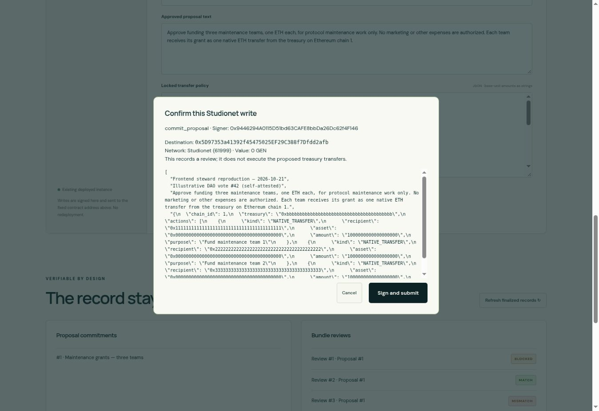
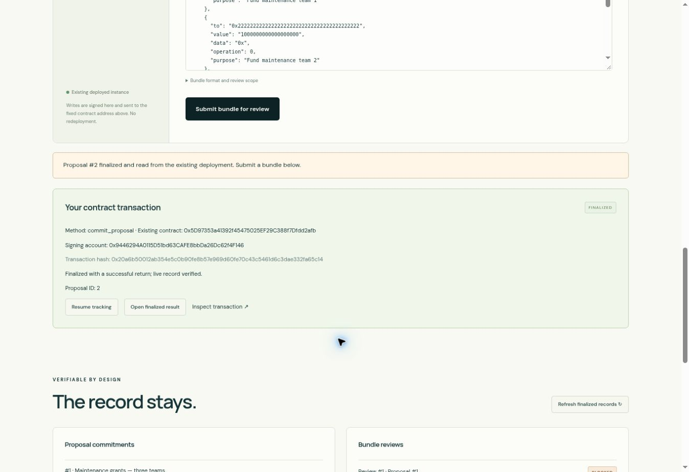
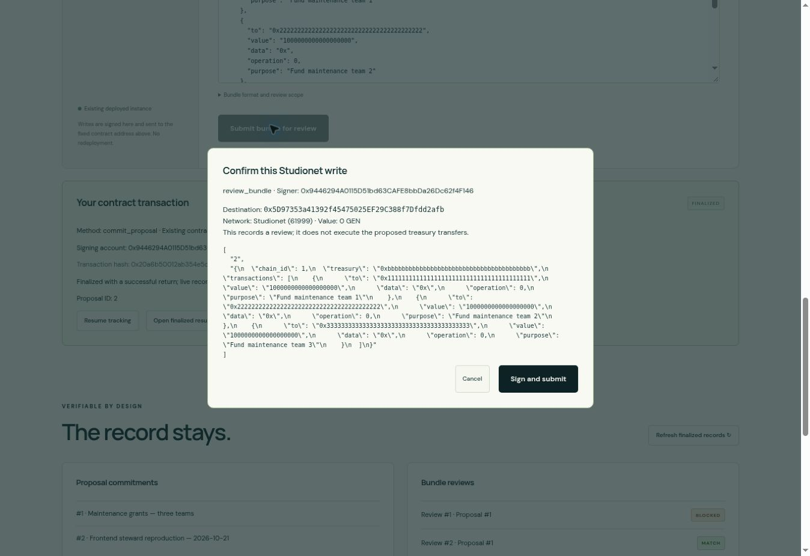
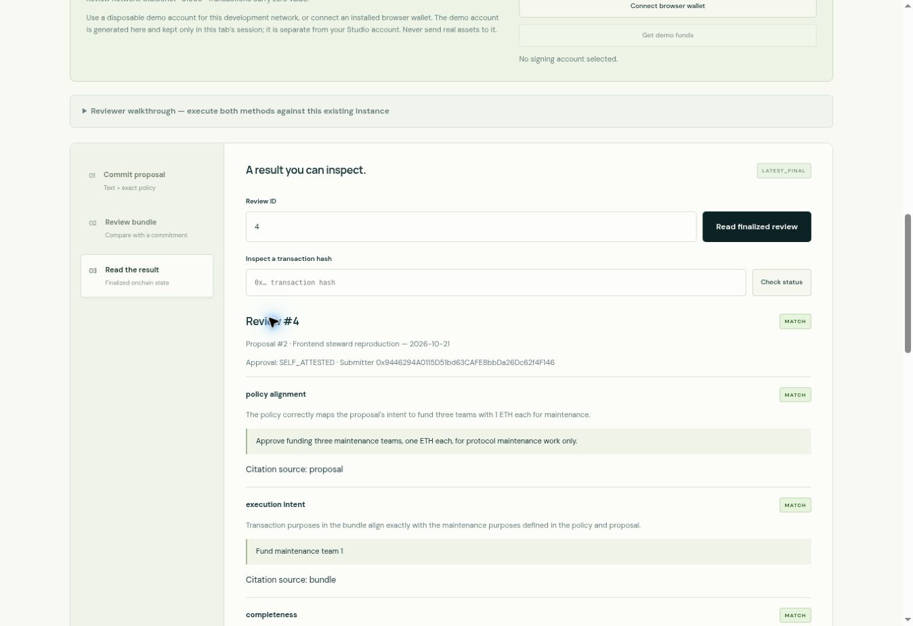
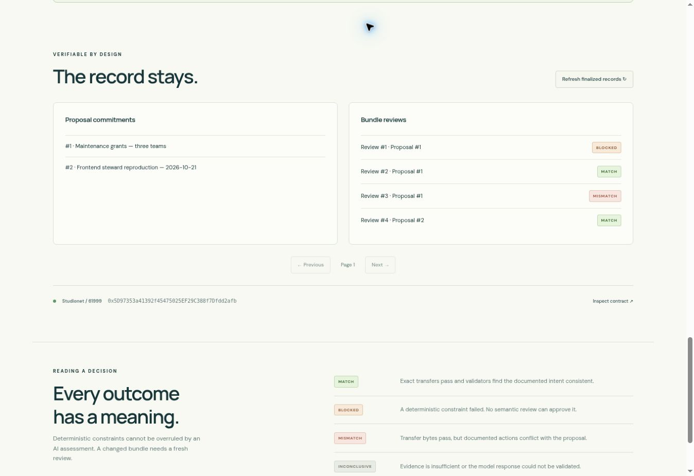

# Published frontend end-to-end demonstration — 2026-10-21

[38-second walkthrough video](https://mandatecheck.itzanza2.chatgpt.site/frontend-demo.mp4) · [Open the resulting live review](https://mandatecheck.itzanza2.chatgpt.site/?review=4#workbench) · [Exported frontend receipt](frontend-demo-receipt.json) · [Independent network verification](frontend-demo-evidence.json)

The video is a labelled sequence of real screenshots taken while operating the published frontend. Consensus wait times are omitted; it is not represented as an uninterrupted real-time recording. The source captures are below, and `scripts/make-demo.py` reproduces the video from them.

## What was actually executed

- Public frontend: `https://mandatecheck.itzanza2.chatgpt.site/`
- Existing deployed Intelligent Contract: `0x5D97353a41392f45475025EF29C388f7Dfdd2afb`
- Review network: Studionet / 61999
- Disposable frontend signer: `0x9446294A0115D51bd63CAFE8bbDa26Dc62f4F146`
- Signing route: app-generated session-local SDK account; no MetaMask extension or Studio workspace was used in this run.
- Execution: Full Consensus, zero transaction value. No contract deployment or upgrade occurred.

| Method | Transaction hash | Finalized returned record |
| --- | --- | --- |
| `commit_proposal` | `0x20a6b50012ab354e5c0b90fe8b57e969d60fe70c43c5461d6c3dae332fa65c14` | Proposal #2 |
| `review_bundle` | `0xaa2673ce72fcf879d5fe7de4a93bfdad2ba3721de5431515b38a9a730a50dcb6` | Review #4, MATCH |

The proposed grants in the inputs are illustrative; no Ethereum treasury transfer occurred. Both calls record data/review decisions in the original GenLayer contract.

## Browser sequence

1. Opened the published workbench. Chose **Use Studionet demo account**, requested demo funds, loaded the maintenance proposal, and gave it the unique title `Frontend steward reproduction — 2026-10-21`.
2. Clicked **Commit proposal on Studionet**, inspected its destination/method/arguments in the confirmation, and clicked **Sign and submit**.
3. The page displayed the real transaction hash, followed consensus, extracted **Proposal ID: 2** from its finalized return, read the live proposal, and populated the review form with that ID and matching transfers.
4. Clicked **Submit bundle for review**, inspected the `review_bundle` confirmation, and submitted directly.
5. Reloaded the page while the review was pending. The same hash was restored. Clicked **Resume tracking** without reconnecting or signing again. No duplicate write was sent.
6. The app extracted **Review ID: 4**, read `get_review("4")` and `get_proposal("2")` using `LATEST_FINAL`, and rendered MATCH with the three semantic checks, supporting excerpts, and hashes.
7. Exported the receipt using the actual frontend download button. `scripts/verify_receipt.py` recomputed all hashes successfully.
8. Opened the records section and confirmed that Proposal #2 and Review #4 appeared in its live lists. Opened the shareable review URL in a separate tab without selecting a signer.

The optional browser-extension wallet path is implemented and covered by provider-level regression tests (correct chain, address changes, signature rejection). This demonstration verifies the complete public frontend using the independent demo-account path; it does not claim a live MetaMask approval test.

## Captures from the live run

### 1. Fixed destination and proposal confirmation

### 2. Finalized proposal ID and transaction hash

### 3. Review submission against the returned proposal ID

### 4. Live finalized review with supporting excerpts

### 5. Both resulting records in the published frontend

